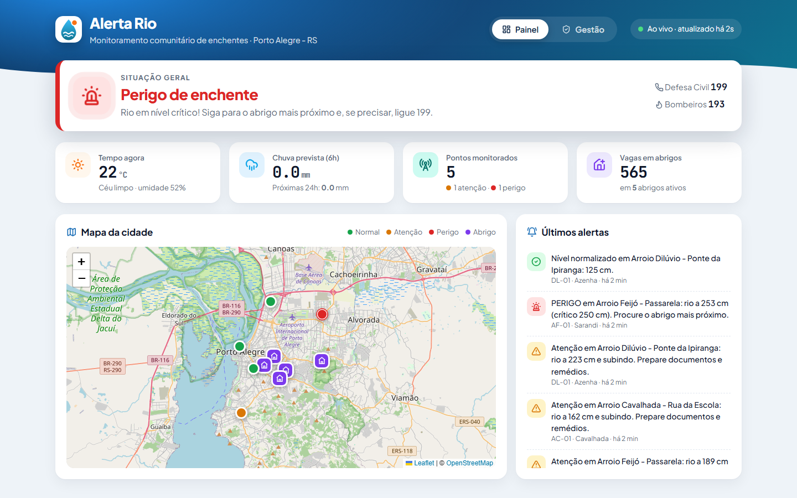

# 🌊 Alerta Rio: monitoramento comunitário de enchentes

> **Global Solution FIAP · CitizenTech · Coding for Security**
> Protótipo que junta sensores de nível do rio, previsão de chuva e abrigos num painel simples,
> para que famílias de áreas de risco saibam **antes** que a água vai chegar.

**ODS 11** (Cidades e comunidades sustentáveis) · **ODS 13** (Ação contra a mudança global do clima)



📄 Relatório completo: [docs/Relatorio_AlertaRio.pdf](docs/Relatorio_AlertaRio.pdf)

---

## 📌 O problema e o cidadão

Em maio de 2024, as enchentes no Rio Grande do Sul atingiram centenas de municípios e
milhões de pessoas. Nos bairros ribeirinhos, muita gente só percebeu o perigo quando a água
já estava dentro de casa. O alerta oficial costuma ser **regional e genérico** ("risco alto de
chuva no estado"), não diz **qual arroio** está subindo, **em quanto tempo** e **para onde ir**.

**Cidadão beneficiado:** famílias que moram perto de arroios, rios e encostas, especialmente
idosos, pessoas com deficiência e quem tem animais (motivo comum para não sair de casa).

**Ecossistema:**

| Quem | Papel |
|---|---|
| Moradores | Acompanham o painel e os alertas, encontram abrigos com vaga |
| Lideranças comunitárias / voluntários | Instalam e mantêm os sensores nas pontes |
| Defesa Civil (operador) | Cadastra sensores e abrigos e atualiza a ocupação |
| Abrigos (escolas, ginásios, igrejas) | Informam capacidade, acessibilidade e se aceitam pets |
| Open-Meteo | Fornece a previsão de chuva (dado aberto) |

---

## 🧱 Arquitetura

```
 ┌───────────────────┐   UDP + HMAC    ┌────────────────────┐
 │ Sensores (simul.) │ ──────────────▶ │ Servidor UDP       │──┐
 │ sensor_simulado.py│ ◀────── ACK ─── │ servidor_udp.py    │  │ grava leituras
 └───────────────────┘                 └────────────────────┘  │ e alertas
                                                                ▼
 ┌───────────────────┐   HTTP/JSON     ┌────────────────────┐  ┌──────────┐
 │ Navegador         │ ──────────────▶ │ API Flask (app.py) │─▶│  MySQL   │
 │ HTML/CSS/JS       │ ◀────────────── │ /api/...           │  │ (SQL puro)│
 └───────────────────┘                 └─────────┬──────────┘  └──────────┘
                                                 │ requests (cache 10 min)
                                                 ▼
                                       ┌────────────────────┐
                                       │ Open-Meteo (clima) │
                                       └────────────────────┘
```

### Modelo de dados

| Tabela | Campos principais | Observação |
|---|---|---|
| `sensores` | codigo (único), nome, bairro, lat/lon, nivel_alerta_cm, nivel_critico_cm, ativo | CHECK: crítico > alerta |
| `leituras` | sensor_id → sensores, nivel_cm, registrado_em | índice (sensor_id, data); CASCADE |
| `alertas` | sensor_id → sensores, nivel_risco (ENUM), nivel_cm, mensagem | criado só quando o risco **muda** |
| `abrigos` | nome, endereço, bairro, lat/lon, capacidade, ocupacao, aceita_pets, acessivel, ativo | CHECK: ocupação ≤ capacidade |

> **LGPD:** não existe tabela de pessoas. O sistema não precisa saber quem é o morador para funcionar.

### Regra de risco (explicável para qualquer pessoa)

1. Nível ≥ crítico → **PERIGO**
2. Nível ≥ alerta → **ATENÇÃO** (vira **PERIGO** se a previsão for ≥ 10 mm nas próximas 6 h)
3. Nível ≥ 70% do alerta **e** previsão ≥ 25 mm em 6 h → **ATENÇÃO**
4. Senão → **NORMAL**

---

## 🗂️ Estrutura de pastas: padrão MVC (Model, View, Controller)

O código segue o padrão **MVC**, em que cada camada tem um papel só:

| Camada | Pasta | Responsabilidade | Não pode... |
|---|---|---|---|
| **Model** | `alerta_rio/models/` | Dados e regras de negócio: SQL no MySQL, Open-Meteo, cálculo de risco | saber de HTTP/HTML (não importa Flask) |
| **View** | `alerta_rio/views/` | Apresentação: página HTML/CSS/JS e formato das respostas JSON | consultar o banco ou decidir regras |
| **Controller** | `alerta_rio/controllers/` | Recebe o pedido (HTTP ou UDP), valida, chama a Model e escolhe a View | escrever SQL |
| Core (apoio) | `alerta_rio/core/` | Validação, segurança, log e rate limiting, usados por todas as camadas | |

Fluxo de uma requisição, por exemplo `POST /api/abrigos`:

```
Navegador ─▶ Controller (abrigo_controller.criar)
                ├─ core/seguranca: confere a chave de operador
                ├─ core/validacao: valida o JSON
                ├─ Model (abrigo.criar): INSERT parametrizado no MySQL
                └─ View (json_view.criado): 201 + Location + JSON
```

```
alerta-rio/
├── app.py                          # ponto de entrada: python app.py
├── alerta_rio/
│   ├── __init__.py                 # criar_app(): junta controllers, views e segurança
│   ├── config.py                   # lê o .env
│   │
│   ├── models/                     # ── M ── dados e regras de negócio
│   │   ├── conexao.py              # pool MySQL + consultas parametrizadas
│   │   ├── sensor.py               # CRUD de sensores (+ risco de cada ponto)
│   │   ├── leitura.py              # leituras de nível
│   │   ├── alerta.py               # alertas de mudança de risco
│   │   ├── abrigo.py               # CRUD de abrigos
│   │   ├── clima.py                # Open-Meteo (requests + JSON, cache)
│   │   └── risco.py                # regra: normal / atenção / perigo
│   │
│   ├── views/                      # ── V ── apresentação
│   │   ├── pagina_view.py          # monta a página do painel
│   │   ├── json_view.py            # respostas JSON padronizadas
│   │   ├── templates/index.html    # HTML do painel
│   │   └── static/                 # CSS, JS, logo, Leaflet, Chart.js, Lucide
│   │
│   ├── controllers/                # ── C ── recebem pedidos e coordenam
│   │   ├── painel_controller.py    # /, /api/resumo, /api/clima, /api/alertas, /api/status
│   │   ├── sensor_controller.py    # /api/sensores (GET, POST, PUT, DELETE)
│   │   ├── abrigo_controller.py    # /api/abrigos  (GET, POST, PUT, DELETE)
│   │   ├── leitura_controller.py   # decide o que fazer com cada pacote UDP
│   │   └── erro_controller.py      # respostas de erro sem detalhes internos
│   │
│   └── core/                       # apoio a todas as camadas
│       ├── validacao.py            # validação de toda entrada
│       ├── seguranca.py            # chave de operador, HMAC, anti-replay, cabeçalhos
│       ├── extensoes.py            # rate limiting (Flask-Limiter)
│       └── log.py                  # log de auditoria em arquivo
│
├── sockets_udp/
│   ├── servidor_udp.py             # só a rede: recebe bytes e devolve ACK
│   └── sensor_simulado.py          # simula sensores (normal, chuva, enchente, baixando, invasor)
├── scripts/setup_banco.py          # cria banco, usuário de privilégio mínimo e dados fictícios
├── database/schema.sql             # modelo de dados
├── tests/                          # pytest (inclui testes que conferem a separação MVC)
├── docs/                           # relatório PDF, screenshots e gerador do relatório
├── logs/                           # alerta_rio.log é gerado aqui
├── requirements.txt
└── .env.example
```

---

## 🚀 Como executar do zero

### 1. Pré-requisitos

- **Python 3.11+** → https://www.python.org/downloads/ (marque *Add Python to PATH*)
- **MySQL 8** → uma das opções:
  - **Instalador oficial:** https://dev.mysql.com/downloads/installer/ (anote a senha do root)
  - **Versão portátil (ZIP, sem instalador):**
    ```powershell
    # 1) Baixe e extraia o ZIP do MySQL 8.4 em C:\mysql
    # 2) Inicialize a pasta de dados (root sem senha, só na primeira vez)
    C:\mysql\bin\mysqld.exe --initialize-insecure --datadir=C:\mysql\data
    # 3) Suba o servidor (deixe esta janela aberta)
    C:\mysql\bin\mysqld.exe --datadir=C:\mysql\data --console
    # 4) Em outro terminal, defina uma senha para o root
    C:\mysql\bin\mysql.exe -u root -e "ALTER USER 'root'@'localhost' IDENTIFIED BY 'SuaSenhaForte';"
    ```
- Internet (para a previsão do tempo, as fontes e o mapa).

### 2. Ambiente Python

```powershell
cd alerta-rio
python -m venv .venv
.\.venv\Scripts\activate          # Linux/Mac: source .venv/bin/activate
pip install -r requirements.txt
```

### 3. Configurar o `.env`

```powershell
copy .env.example .env            # Linux/Mac: cp .env.example .env
```

Abra o `.env` e troque as três senhas/chaves. Para gerar valores fortes:

```powershell
python -c "import secrets; print(secrets.token_urlsafe(32))"
```

### 4. Criar o banco (estrutura + usuário + dados fictícios)

```powershell
python -m scripts.setup_banco
# vai pedir a senha do root (ela não é salva em lugar nenhum)
```

### 5. Rodar (3 terminais, todos com o `.venv` ativado)

| Terminal | Comando | O que faz |
|---|---|---|
| 1 | `python app.py` | API + painel em **http://127.0.0.1:5000** |
| 2 | `python -m sockets_udp.servidor_udp` | Recebe as leituras dos sensores (UDP 5005) |
| 3 | `python -m sockets_udp.sensor_simulado --cenario enchente` | Simula a cheia 🌧️ |

Outros cenários do simulador: `normal`, `chuva`, `baixando` e `--invasor` (testa as defesas).

### 6. Testes automatizados

```powershell
python -m pytest -v
```

Os testes não precisam do MySQL: o banco é substituído por dados falsos.

---

## 🔌 Endpoints da API

| Método | Rota | Descrição | Status |
|---|---|---|---|
| GET | `/api/status` | Saúde da API e do banco | 200 / 503 |
| GET | `/api/resumo` | Risco geral, sensores com risco, vagas | 200 |
| GET | `/api/clima` | Previsão Open-Meteo (cache 10 min) | 200 / 503 |
| GET | `/api/sensores` · `/api/sensores/<id>` | Lista / detalhe | 200 / 404 |
| POST | `/api/sensores` 🔑 | Cadastra sensor | 201 / 400 / 401 / 409 / 415 |
| PUT | `/api/sensores/<id>` 🔑 | Atualiza sensor | 200 / 400 / 401 / 404 / 409 |
| DELETE | `/api/sensores/<id>` 🔑 | Exclui sensor (e leituras) | 204 / 401 / 404 |
| GET | `/api/sensores/<id>/leituras?limite=40` | Histórico de nível | 200 / 400 / 404 |
| GET / POST / PUT / DELETE | `/api/abrigos[/<id>]` | CRUD de abrigos (escrita 🔑) | idem |
| GET | `/api/alertas?limite=20` | Linha do tempo de alertas | 200 |
| GET | `/api/operador/verificar` 🔑 | Confere a chave de operador | 200 / 401 |

🔑 = exige o cabeçalho `X-API-Key` com a chave do `.env`. Mais de 30 escritas por minuto (por IP) recebem **429**.

**Exemplo (PowerShell):**

```powershell
$chave = @{ "X-API-Key" = "<sua API_KEY_OPERADOR>" }
$corpo = @{ nome="Abrigo Escola Sol"; endereco="Rua Exemplo, 10"; bairro="Centro";
            latitude=-30.03; longitude=-51.22; capacidade=80; ocupacao=0;
            aceita_pets=$true; acessivel=$true } | ConvertTo-Json
Invoke-RestMethod http://127.0.0.1:5000/api/abrigos -Method Post -Headers $chave -Body $corpo -ContentType "application/json"
```

**Exemplo (curl):**

```bash
curl -X DELETE http://127.0.0.1:5000/api/abrigos/3 -H "X-API-Key: <sua chave>" -i
```

---

## 🔐 Segurança e privacidade

| Requisito | Como foi feito |
|---|---|
| Credenciais em `.env` | `alerta_rio/config.py` lê tudo do `.env`; `.env` está no `.gitignore`; há `.env.example` |
| Consultas parametrizadas | Todas as queries usam `%s` (camada `models/`), sem ORM |
| Validação de entrada | `core/validacao.py`: tipo, tamanho, regex, faixa, regra de negócio e recusa de campos extras |
| Erros sem detalhes internos | `controllers/erro_controller.py` devolve mensagens genéricas; detalhe só no log |
| Coleta mínima (LGPD) | Nenhum dado pessoal coletado; log não guarda IP nem chaves |
| Privilégio mínimo | Usuário `alerta_app` só tem SELECT/INSERT/UPDATE/DELETE no banco |
| Autenticação de escrita | Chave de operador (`X-API-Key`) comparada em tempo constante |
| Integridade dos sensores | Assinatura **HMAC-SHA256** + janela de 30 s + anti-replay |
| XSS / Clickjacking | Front usa só `textContent`; CSP, `X-Frame-Options`, `nosniff` |
| Abuso | Rate limiting (Flask-Limiter) e corpo máximo de 16 KB |

### Log de auditoria (`logs/alerta_rio.log`)

```
2026-11-09 16:29:35 | WARNING | API    | POST /api/sensores     | NEGADO   | chave de operador ausente/inválida
2026-11-09 16:29:35 | INFO    | API    | CRIAR_SENSOR           | SUCESSO  | id=6 codigo=TS-99
2026-11-09 16:29:46 | INFO    | UDP    | NOVO_ALERTA            | ATENCAO  | codigo=AF-01 nivel=189.0
```

---

## ✨ Recursos além do conteúdo (bônus)

| Recurso | Por que usamos |
|---|---|
| **HMAC-SHA256 + anti-replay** nos pacotes UDP | UDP não tem autenticação; sem isso qualquer um forjaria um nível falso |
| **Flask-Limiter** (rate limiting) | Freia força bruta na chave de operador e abuso da API |
| **Content-Security-Policy** e cabeçalhos | Segunda camada contra XSS e clickjacking |
| **Pool de conexões** MySQL | Reaproveita conexões; API e servidor UDP rodam juntos sem sobrecarga |
| **Leaflet + OpenStreetMap** | Mapa é a forma mais natural de um morador achar o abrigo mais perto |
| **Chart.js** | Mostra a tendência do rio (subindo/baixando) num relance |
| **Rich** | Terminal colorido no servidor UDP: facilita a demonstração ao vivo |
| **pytest** (37 testes) | Garante status HTTP, validação, risco, HMAC e a separação MVC sem precisar do banco |
| Cache da previsão (10 min) | Respeita o serviço gratuito e deixa o painel rápido |

---

## ⚠️ Limitações

- Sensores são **simulados**; em campo seriam ESP32 + sensor ultrassônico, com bateria e 4G/LoRa.
- Os limiares de alerta/crítico são fictícios. Na prática viriam de cotas históricas da Defesa Civil/ANA.
- Sem envio de SMS/WhatsApp: o morador precisa abrir o painel (próximo passo natural).
- A chave de operador é única; o ideal seria login individual com perfis.
- Rodando localmente (HTTP). Em produção: HTTPS, banco gerenciado e rate limit com Redis.

---

**Dados:** sensores, abrigos e leituras são **fictícios**. Os bairros citados existem em Porto Alegre,
mas pontos, endereços e níveis foram inventados para fins acadêmicos.
Previsão do tempo: [Open-Meteo](https://open-meteo.com) (CC BY 4.0). Mapa: © OpenStreetMap.
